  

#### `magomin~/dev $ ls -la ~/projects`

| file | description | tags | links |
|---|---|---|---|
| **re-track/** | Learn Ableton Live by rebuilding real songs. AI reverse-engineers a track and turns it into an interactive lesson verified against the live state of your set, not screenshots. | `python` `ableton` `open source` | [-> source](https://github.com/Magomin/re-track) |
| **cadlan-ai-hub/** | Internal roadmap and tooling for bringing AI agents into an engineering team. | `next.js` `vercel` `private` | |
| **interactive/** | My portfolio as a small 2D world you walk through. | `react` `kaplay` | [-> live](https://matdomi.vercel.app) · [-> source](https://github.com/Magomin/interactive) |
| **fribl-outbound/** | B2B multichannel prospecting platform built solo in 2026: sequences, workflow builder, unified inbox, CRM, A/B tests. | `typescript` `next.js` `postgres` `private` | |
| **FriblLinkedinScraper/** | Threaded LinkedIn profile scraper feeding an AI recruiting pipeline (2024). | `python` `archived` | [-> source](https://github.com/Magomin/FriblLinkedinScraper) |

  
  

