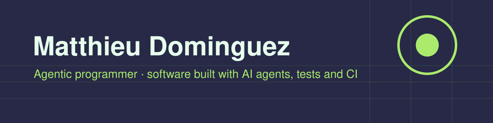

  

### Hi, I'm Matthieu

Agentic programmer: I build software by directing AI agents, with tests and CI as the judge. At **Cad&Lan** I bring that way of working to a building-automation engineering team and ship the internal tools it needs. Before that, two years in growth and product at an AI recruiting startup, where I shipped an internal prospecting platform end to end.

Every project here is written with agents and reviewed line by line. The tests run on every pull request.

### Now

| | |
|---|---|
| [**re-track**](https://github.com/Magomin/re-track) | Learn Ableton Live by rebuilding real songs. AI reverse-engineers a track and turns it into an interactive lesson verified against the live state of your set, not screenshots. Python. Early development. |
| **Cad&Lan AI hub** | Internal roadmap and tooling for bringing AI agents into an engineering team. Private. |
| [**matdomi.vercel.app**](https://matdomi.vercel.app) | My portfolio as a small 2D world you walk through. React + Kaplay, [source](https://github.com/Magomin/interactive). |

### Earlier

- **Fribl Outbound** (2026): B2B multichannel prospecting platform built solo. Sequences, visual workflow builder, unified inbox, CRM, A/B tests. TypeScript, Next.js, PostgreSQL. Private.
- [**FriblLinkedinScraper**](https://github.com/Magomin/FriblLinkedinScraper) (2024): threaded LinkedIn profile scraper feeding an AI recruiting pipeline. Archived.

### Stack

### Find me

[LinkedIn](https://www.linkedin.com/in/matt-domi/) · [matdomi.vercel.app](https://matdomi.vercel.app)
